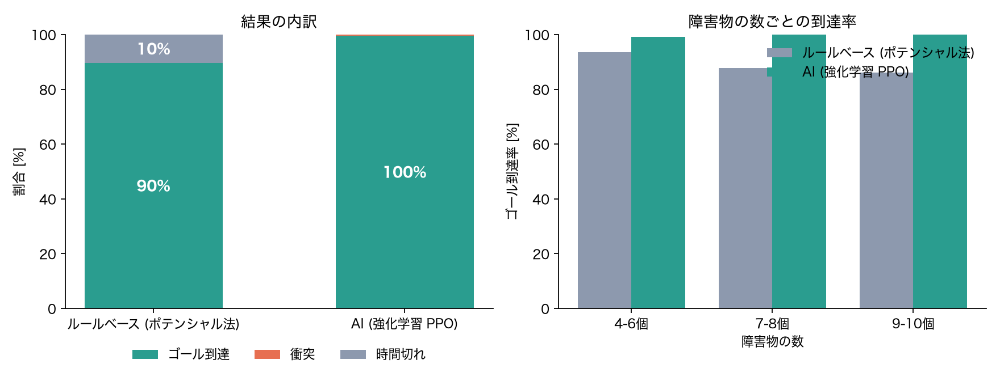
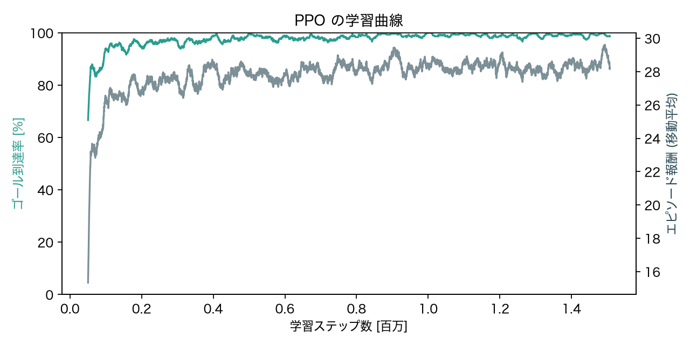

# AIで自律走行する差動二輪ロボット — 強化学習による障害物回避ナビゲーション

Physical AI 応用1講座 最終課題の提出コードです。

差動二輪ロボットを物理シミュレータ **MuJoCo** 上に作り，**強化学習 (PPO)** で学習したニューラルネットワークに，
距離センサ (LiDAR 相当) の値とゴール方向だけから速度指令 (`cmd_vel` 相当の並進速度 v・角速度 ω) を出させます。
障害物の数・形・配置が毎回ランダムに変わるアリーナで，ぶつからずにゴールへ向かいます。

## サンプルからの発展

最終課題サンプル「ROS2 と Gazebo の連携によるロボット操作」(差動二輪ロボットを SDF で作り，キーボード → teleop ノード → `/cmd_vel` → Gazebo で動かす) をベースにしています。

| | サンプル | 本作品 |
|---|---|---|
| ロボット | 差動二輪 + キャスター (SDF) | 差動二輪 + キャスター 2 個 (MJCF) |
| 指令 | `/cmd_vel` (v, ω) | 同じく (v, ω) を左右の車輪速度に変換 |
| 誰が指令を決めるか | 人 (キーボード) | **AI (PPO で学習したニューラルネット)** |
| センサ | なし | 距離センサ 16 本 (全周, 最大 2 m) |
| 環境 | 平らな地面 | 5 m 四方のアリーナ + ランダムな障害物 4〜10 個 |
| 評価 | 動けば OK | ルールベースと同じ 300 配置で比較し到達率を定量評価 |

## 仕組み

- **観測 (21 次元)**: 距離センサ 16 本 / ゴールまでの距離 / ゴール方位の sin・cos / 現在の並進速度・角速度
- **行動 (2 次元)**: 並進速度指令 v (前進 最大 0.5 m/s, 後退 最大 0.15 m/s)，角速度指令 ω (最大 2 rad/s)。
  差動二輪の運動学 `ω_L = (v − ω·d/2)/r, ω_R = (v + ω·d/2)/r` で車輪の目標角速度に変換し，速度制御アクチュエータで駆動
- **報酬**: ゴールに近づいた距離 × 8 / 時間ペナルティ −0.005 / 障害物に 0.25 m 以内へ近づくと小さなペナルティ / 衝突で −10 (終了) / 到達で +10 (終了)
- **学習**: Stable-Baselines3 の PPO (方策・価値ネットとも 256×256 の全結合)，8 環境並列，約 150 万ステップ。ノート PC (Apple Silicon) の CPU のみで約 6 分
- **比較対象**: ポテンシャル法 (ゴールへの引力 + 近い障害物からの斥力) によるルールベース制御

## ファイル構成

```
diffbot_nav/
  env.py          ロボットとアリーナのモデル (MJCF を Python で生成), Gymnasium 環境
  controllers.py  ルールベース制御器 / 学習済み PPO 制御器
check_env.py      動作確認 (前進・旋回・センサ・描画)
train.py          PPO の学習
evaluate.py       ルールベースと AI を同じ 300 配置で比較, 学習曲線の作図
make_video.py     提出用デモ動画 (約 2 分, 等速) の生成
models/           学習済みモデル (best/best_model.zip を評価・動画に使用)
results/          評価結果 (eval_summary.md, comparison.png, learning_curve.png)
setup.sh          仮想環境の作成とライブラリのインストール
run_all.sh        動作確認 → 学習 → 評価 → 動画生成 を一括実行
```

## 動かし方

Python 3.11〜3.13 推奨 (macOS / Linux / Windows で動作。GPU 不要)。

```bash
bash setup.sh                 # .venv を作ってライブラリを入れ, 動作確認
bash run_all.sh               # 学習 → 評価 → 動画生成
```

学習済みモデルだけで試す場合:

```bash
source .venv/bin/activate
python evaluate.py --model models/best/best_model.zip --episodes 300
python make_video.py --model models/best/best_model.zip
```

## 結果

学習に使っていない 300 通りのランダムな配置で，同じスタート・ゴールから走らせた結果:

| 制御器 | ゴール到達率 | 衝突率 | 時間切れ | 到達時の平均所要時間 | 到達時の平均経路長 |
|---|---|---|---|---|---|
| ルールベース (ポテンシャル法) | 89.7% | 0.0% | 10.3% | 5.9 s | 2.51 m |
| **AI (強化学習 PPO)** | **99.7%** | 0.3% | 0.0% | 5.3 s | 2.53 m |

- ルールベースの失敗はすべて，障害物の手前で引力と斥力が釣り合って止まる「局所解」による時間切れ。障害物が多いほど到達率が下がる (4〜6 個: 93.5% → 9〜10 個: 86.2%)
- AI は障害物の数によらずほぼ 100% 到達。一方で 300 回中 1 回衝突した




デモ動画: (YouTube の URL)

## 使用ライブラリ

MuJoCo, Gymnasium, Stable-Baselines3, PyTorch, NumPy, OpenCV, Pillow, Matplotlib, imageio
